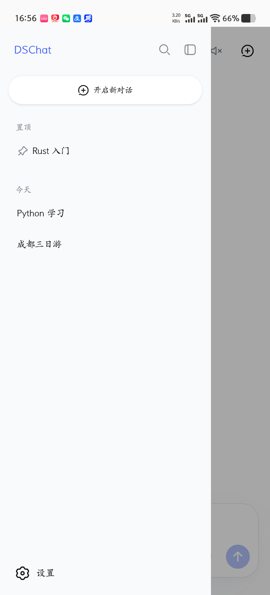
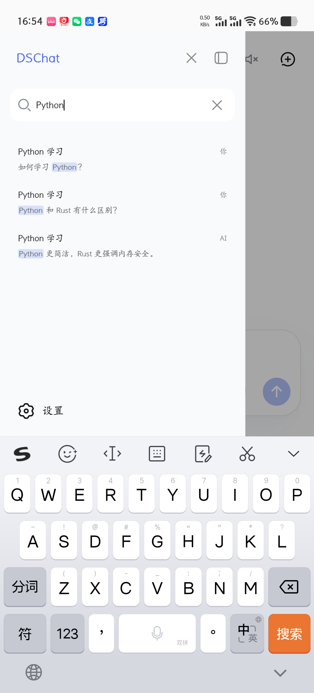
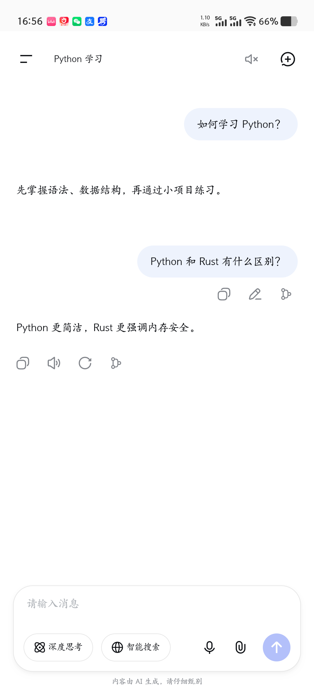
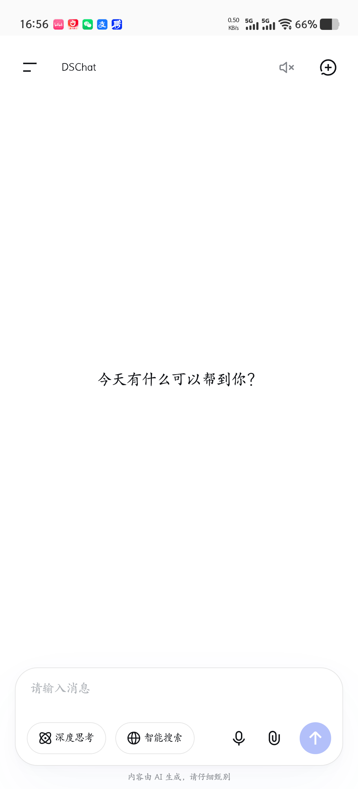

# DSChat

English | [简体中文](README.zh-CN.md)

**DSChat** is an open-source DeepSeek API chat client built on DeepSeek's official
open-source [`chat-demo`](https://github.com/deepseek-ai/chat-demo) framework (MIT).
It aims to be a first-class community client: local-first, BYOK, and pleasant to use on
both the web and Android.

> DeepSeek publishes `chat-demo` openly under the MIT license. DSChat builds on that
> foundation. It is an independent community project, not an official DeepSeek product and
> not endorsed by DeepSeek. "DeepSeek" is a trademark of its owner.

- Repository: [ADE150/deepseek-api-chat](https://github.com/ADE150/deepseek-api-chat)
- Android package: `io.github.ade150.dschat`
- License: MIT

| Drawer | Message search |
| --- | --- |
|  |  |

| Conversation forking | Welcome |
| --- | --- |
|  |  |

## Features

- Streaming chat, deep thinking, web search, link reading, and source citations.
- Attachments: images, PDF, Office documents, text, and code.
- Markdown, syntax highlighting, KaTeX, and Mermaid.
- **Conversation forking**: continue from any assistant reply in a new conversation while
  keeping the original conversation untouched.
- **Pinned conversations**: pin any chat to the top; unpin it from the same menu.
- **Message search**: search across all conversations and show one result per matching
  message. A conversation with multiple hits appears multiple times; clicking a result
  opens the conversation and scrolls to that message.
- **Interactive mobile drawer**: drag from the left side to reveal the drawer. It follows
  your finger, dims the page proportionally, and settles with an animation. Swipe left on
  the drawer to close it.
- **Auto read-aloud**: a header toggle makes every newly completed assistant reply speak
  automatically. The setting is persisted.
- **In-app image viewer**: full-screen image preview with image-only pinch zoom, double-tap
  zoom, vertical scrolling for long screenshots, a close button, and Android back-key
  support; back returns to the same conversation.
- Simplified Chinese / English UI, light / dark / system theme, mobile layout.
- PWA: installable from a browser, offline app shell.
- Android APK via Capacitor, with microphone permission, file picker, native share for
  history export, and left-edge gesture exclusion for the drawer.
- History import/export in the DeepSeek v3 ZIP format.

## How forking works

Sessions are stored as a message tree (`parentId` / `selectedChildId`). Forking copies only
the currently selected path into a new session:

- Fork on an **assistant** message: the new conversation includes that answer.
- Fork on a **user** message: the new conversation is created *before* that question, so it
  does not end with an unanswered message.
- Every copied message gets a new ID; attachments are shared by ID and cleaned up by
  reference count.
- The new session stores `forkedFrom` locally for future branch-graph views.

## Search and pinning

- Pinned sessions are stored locally and shown in a separate **Pinned** group above the
  normal time groups.
- Search reads the currently selected branch of every conversation and matches user
  questions and assistant text. Results are message-level, not conversation-level.
- Search is debounced and runs against IndexedDB, so it also covers conversations that are
  not currently open.

## Web development

Requirements: Node.js 22.12+ and pnpm.

```sh
pnpm install
pnpm dev      # http://localhost:8090
pnpm type
pnpm lint
pnpm build    # dist/
```

`pnpm build` is cross-platform. Serve `dist/` over HTTPS (or `localhost`) to use the PWA.
The service worker is registered only in production web builds; it is skipped inside the
Android WebView.

## Android APK

Requirements: JDK 21, Android SDK with platform 36, and `ANDROID_HOME` (or the SDK in the
default Windows location). Minimum Android version: 7.0 (API 24).

```sh
pnpm android:apk
```

The debug APK is written to:

```text
android/app/build/outputs/apk/debug/app-debug.apk
```

Install it on a connected device:

```sh
adb install -r android/app/build/outputs/apk/debug/app-debug.apk
```

Other helper scripts:

```sh
pnpm assets        # regenerate Android icons and splash screens
pnpm android:sync  # build web assets and sync them into the Android project
```

For a release build, create `android/keystore.properties` (gitignored):

```properties
storeFile=keystore/dschat-release.jks
storePassword=...
keyAlias=dschat
keyPassword=...
```

Put the keystore under `android/keystore/` (also gitignored), then run:

```sh
node scripts/android-build.mjs assembleRelease
```

Back up the keystore and passwords. Future updates must be signed with the same key.

## Data and privacy

- The API key is stored in this browser/WebView's `localStorage` (`dschat:api-key`).
  It is never written to the repository or the APK.
- Conversations and attachment originals live in IndexedDB (`dschat`).
- There is no application backend. Requests go directly from the client to
  `https://api.deepseek.com/anthropic/v1`.
- Android sets `android:allowBackup="false"` so the API key and chats are not included in
  cloud backups. Uninstalling the app removes its local data.
- Exported history uses the DeepSeek v3 ZIP format and does not include the API key or app
  settings.

## Project structure

```text
src/
  app/          layout, theme, native bridge, drawer gesture
  components/   chat, settings, Markdown, messages, sidebar
  i18n/         Chinese and English strings
  services/
    api/        Messages API, SSE, speech
    chat/       sessions, branches, storage, search, history import/export
    markdown/   Markdown, highlighting, KaTeX, Mermaid
    speech/     recording and read-aloud
  utils/
android/        Capacitor Android project
public/         manifest, service worker, icons
scripts/        asset generation and cross-platform build helpers
```

## Roadmap

- Persona / system-prompt presets.
- Visual branch graph across forked sessions.
- More native integrations: share targets, notifications, and file opening.
- Release signing and store-ready builds.

## Contributing

Issues and pull requests are welcome. Please keep changes focused, keep user data
local-first, and preserve the upstream MIT notice.

## Credits and license

Based on [deepseek-ai/chat-demo](https://github.com/deepseek-ai/chat-demo), MIT licensed.
See [LICENSE](LICENSE) and [NOTICE.md](NOTICE.md).

DSChat is an independent community project. Please do not present it as an official
DeepSeek application.
