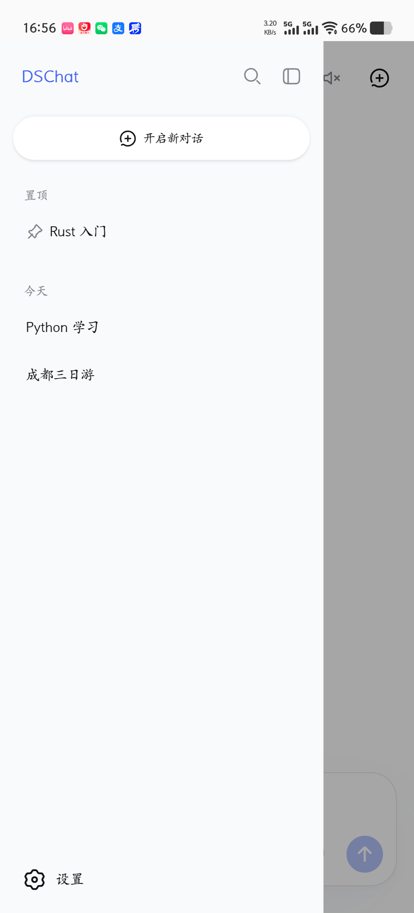
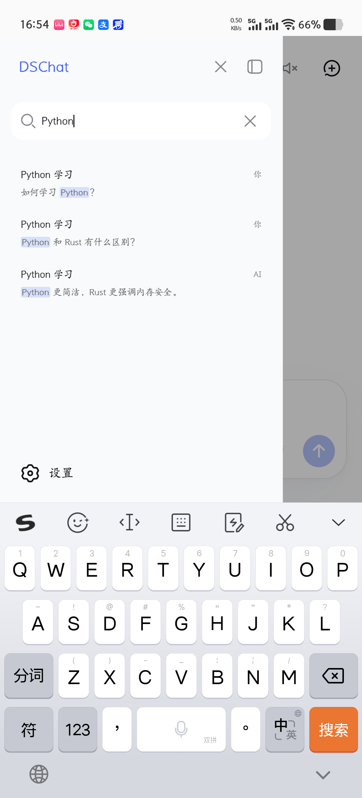
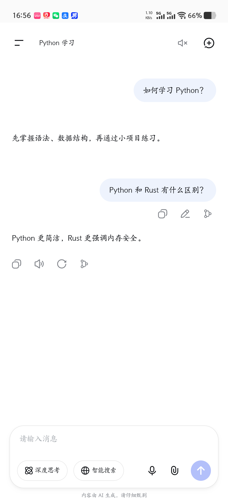
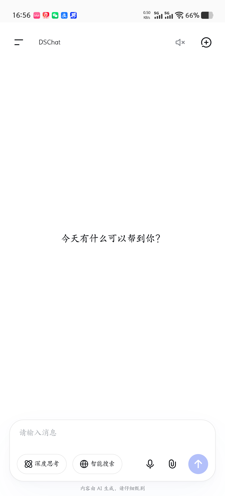
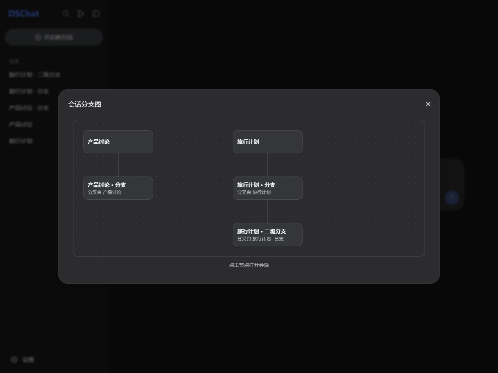

# DSChat

[English](README.md) | 简体中文

**DSChat** 是一个基于 DeepSeek 官方开源 [`chat-demo`](https://github.com/deepseek-ai/chat-demo)
框架（MIT）构建的 DeepSeek API 聊天客户端。目标是把它做成一个真正好用的社区客户端：
本地优先、BYOK、Web 与 Android 都有良好体验。

> DeepSeek 以 MIT 协议开源了 `chat-demo`，DSChat 在这份框架之上继续开发。
> DSChat 是独立社区项目，不是 DeepSeek 官方产品，也不代表 DeepSeek 官方背书。
> “DeepSeek” 是其权利人的商标。

- 代码仓库：[ADE150/deepseek-api-chat](https://github.com/ADE150/deepseek-api-chat)
- Android 包名：`io.github.ade150.dschat`
- 许可证：MIT

| 抽屉 | 消息搜索 |
| --- | --- |
|  |  |

| 会话分叉 | 欢迎页 |
| --- | --- |
|  |  |



## 功能

- 流式聊天、深度思考、智能搜索、链接阅读与来源引用。
- 附件：图片、PDF、Office 文档、文本和代码。
- Markdown、代码高亮、KaTeX 公式、Mermaid 图表。
- **会话分叉**：从任意回答继续出一条新对话，原对话保持不变。
- **会话置顶**：任意会话可置顶/取消置顶，置顶项单独分组排在前面。
- **消息级搜索**：跨会话搜索，每条命中的消息单独显示。同一会话命中多条消息时会
  重复出现；点击结果会打开会话并滚动到对应消息。
- **人设预设**：新建、编辑、删除并启用带名称的系统提示词，当前人设会随每次请求发送。
- **跨会话分支图**：可视化展示分叉会话，点击节点直接打开对应会话。
- **跟手抽屉**：移动端从左侧向右滑，抽屉随手指平移、遮罩同步变暗，松手后吸附并播放
  过渡动画；在抽屉上向左滑可关闭。
- **自动朗读**：顶栏开关，开启后新完成的 AI 回复自动朗读，设置持久化。
- **应用内图片查看器**：全屏查看附件图片，支持图片级双指缩放、双击缩放、长截图上下
  滚动、关闭按钮和 Android 返回键，返回后仍停留在原会话。
- 中英文界面、浅色/深色/跟随系统主题、移动端布局。
- PWA：浏览器安装、离线应用壳。
- Android APK：Capacitor 打包，支持麦克风权限、文件选择器、历史导出原生分享，以及
  Android 左边缘手势排除区。

## 分叉规则

会话本身是消息树（`parentId` / `selectedChildId`）。分叉只复制当前选中的路径：

- 在 **assistant** 消息上分叉：新会话包含这条回答。
- 在 **user** 消息上分叉：在这条提问**之前**创建新会话，避免以没有回答的提问结尾。
- 复制出的消息全部生成新 ID；附件按 ID 共享，删除会话时按引用计数清理。
- 新会话在本地保存 `forkedFrom`，为后续分支图保留来源。

## 搜索与置顶

- 置顶状态保存在本地，侧栏会显示独立的“置顶”分组，排在普通时间分组之前。
- 搜索遍历每个会话当前选中分支中的用户提问和 AI 正文，按消息返回结果。
- 搜索有 180ms 防抖，直接读 IndexedDB，因此未打开的会话也能被搜索到。

## Web 开发

需要 Node.js 22.12+ 和 pnpm。

```sh
pnpm install
pnpm dev      # http://localhost:8090
pnpm type
pnpm lint
pnpm build    # 产物在 dist/
```

`pnpm build` 已做跨平台处理。把 `dist/` 部署到 HTTPS（或 localhost）即可使用 PWA。
service worker 只在生产 Web 构建注册，Android WebView 内跳过。

## Android APK

需要 JDK 21、Android SDK platform 36，并设置 `ANDROID_HOME`（或使用 Windows 默认 SDK 路径）。
最低支持 Android 7.0（API 24）。

```sh
pnpm android:apk
```

Debug APK 位于：

```text
android/app/build/outputs/apk/debug/app-debug.apk
```

安装到已连接设备：

```sh
adb install -r android/app/build/outputs/apk/debug/app-debug.apk
```

其他命令：

```sh
pnpm assets        # 重新生成 Android 图标和启动图
pnpm android:sync  # 构建 Web 产物并同步到 Android 工程
```

发布版请创建 `android/keystore.properties`（已加入 gitignore）：

```properties
storeFile=keystore/dschat-release.jks
storePassword=...
keyAlias=dschat
keyPassword=...
```

把 keystore 放在 `android/keystore/`（同样已忽略），然后运行：

```sh
node scripts/android-build.mjs assembleRelease
```

务必单独备份 keystore 和密码；后续更新必须使用同一签名。

## 数据与隐私

- API Key 存在浏览器/WebView 的 `localStorage`（`dschat:api-key`），不会写进仓库或 APK。
- 会话与附件原件存在 IndexedDB（`dschat`）。
- 没有应用后端，请求由客户端直接发往 `https://api.deepseek.com/anthropic/v1`。
- Android 设置 `android:allowBackup="false"`，API Key 和会话不会进入云备份；卸载应用会删除本地数据。
- 导出的历史使用 DeepSeek v3 ZIP 格式，不包含 API Key 和应用设置。

## 目录结构

```text
src/
  app/          布局、主题、原生桥接、抽屉手势
  components/   聊天、设置、Markdown、消息、侧栏组件
  i18n/         中英文文案
  services/
    api/        Messages API、SSE、语音
    chat/       会话、分支、存储、搜索、历史导入导出
    markdown/   Markdown、代码高亮、KaTeX、Mermaid
    speech/     录音与朗读
  utils/
android/        Capacitor Android 工程
public/         manifest、service worker、图标
scripts/        资源生成与跨平台构建脚本
```

## 路线

- 人设 / 系统提示词预设。
- 跨会话分支图可视化。
- 更多原生集成：系统分享目标、通知、文件打开。
- Release 签名与商店发布版本。

## 贡献

欢迎提交 Issue 和 Pull Request。请保持改动聚焦、坚持本地优先的数据策略，并保留上游
MIT 协议与署名。

## 致谢与许可

基于 [deepseek-ai/chat-demo](https://github.com/deepseek-ai/chat-demo)，MIT 许可。
见 [LICENSE](LICENSE) 和 [NOTICE.md](NOTICE.md)。

DSChat 是独立社区项目，请不要把它当作 DeepSeek 官方应用。
